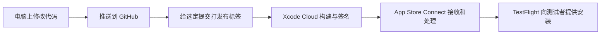

# Mikansei 第一次 TestFlight 发布：从自己的项目学会上线

> 发布日期：2026-10-29。你已通过 TestFlight 下载 **0.5.0（Build 5）**，截图显示“打开”。这次从源码到可安装测试版的发布流程已经走通。
>
> 云账号注销接口也已部署并核对权限；真实邮箱登录、同步与注销操作尚未完成端到端验收。
>
> 本文记录的是原生 Mikansei 的 TestFlight 测试版发布。正式在 App Store 面向所有人上架，还需要另一套商店资料、审核和发布步骤。

## 先花一分钟看懂结果

| 你关心的事 | 本次结果 |
| --- | --- |
| 以后还要请 Paul 每次帮忙构建吗 | 现有云流程可自行触发；团队权限、协议或服务配置变化时再请管理员协助 |
| 本次装的是什么 | 原生 Mikansei，0.5.0（Build 5），由冰岩科技团队发布 |
| 标签对应哪份代码 | `v0.5.0` → `ba2ecf1` |
| 为什么资料里还有（11） | 11 是源码中的构建号；Xcode Cloud 最终分配的是 5 |
| 现在谁都能在商店搜到吗 | 本次完成 TestFlight；未确认外部测试公开链接或正式 App Store 上架 |
| Supabase 完成到哪一步 | 客户端已打包，注销接口已部署；真实账号流程待验收 |

## 先记住这张路线图



可以把它理解成生产一件产品：

- **GitHub 是图纸仓库**：保存源码和每次修改。
- **Xcode Cloud 是苹果提供的工厂**：取出指定版本的源码，把它构建成 App，再完成发布所需的签名步骤。
- **App Store Connect 是发布后台**：管理 App 记录、构建、测试资料和分发状态。
- **TestFlight 是测试版交付渠道**：让获准的测试者安装测试版本。
- **Supabase 是 App 使用的在线服务**：提供账号和数据同步。把 App 发出去，与把它依赖的后台功能配好，是两项工作。

### 顺手弄懂四个常见词

| 术语 | 在做什么 |
| --- | --- |
| 构建／Build | 把人写的源码转换成手机能运行的程序和资源 |
| 归档／Archive | 保存一次用于发布的完整构建及相关信息，方便上传、分发和排查 |
| 签名／Signing | 用开发者团队的身份给 App 签名，让系统核验来源及完整性 |
| 描述文件／Provisioning Profile | 将 App 身份、团队、可用能力和相应安装／分发条件关联起来 |

本地开发安装、无签名编译检查、TestFlight 分发需要的条件不同。做到了前一项，不能自动推断后一项也已完成。

## 一、第一次需要别人帮忙配置什么

Mikansei 使用 Bingyan 的 Apple 开发者团队发布。Paul 已经完成了团队侧的发布流程配置，并告诉我们：修好代码后，打标签就会触发 Xcode Cloud。

Apple 账号是“你是谁”，开发者团队是“以谁的身份开发和发行”，App Store Connect 中的角色与 App 访问权限则决定“你能管理什么”。加入团队之后，仍应结合具体操作核对权限；本项目已经能使用配置好的云工作流。

本项目已经确定的发布身份是：

| 名称 | 本次项目中的值 | 可以怎样理解 |
| --- | --- | --- |
| Team ID | `6PVAPR495F` | 以哪个开发者团队的名义发布 |
| 主应用 Bundle ID | `net.bingyan.KikuchiHeinrich.mikansei` | 这个 App 的固定身份 |
| Widget Bundle ID | 主应用 ID 加 `.widgets` | 小组件有自己的身份，但属于同一个主应用 |
| App Store Connect App ID | `6827965680` | 发布后台中这条 App 记录的编号 |
| 工作流 | `Internal TestFlight Build` | 苹果云端执行的发布流程 |

这些身份应保持稳定。尤其不要为了绕过构建错误随意更换 Bundle ID：系统通常会把不同 Bundle ID 视为不同 App，本机数据和安装关系也会受到影响。

**一次配置好流水线后，后续版本通常由开发者自己维护源码、触发构建和检查结果。** 不需要每次把 ZIP 发给最初配置流程的人，请他代操作。

## 二、为什么“我没有本机签名权限”不等于“云端不能发布”

这次 Xcode 的团队详情显示了 Developer 角色，但证书和描述文件访问项有红叉；本机签名归档也返回了 `No Account for Team`。

这说明本机这条签名路径没有成功。Paul 早已配置的 Xcode Cloud 是另一条发布路径。

这次协作中，AI 曾把本机失败进一步推成“必须继续让 Paul 代构建”。这是判断失误，导致了不必要的交接和沟通；正确做法应当是直接使用他已配置的云端流程。

这次可以学到一个排查方法：

> 先确认我们正在走哪条发布路径，再判断眼前缺少的权限是否会阻断这条路径。

不用一看到“证书”就开始到处找证书，也不要根据某个本机错误推断整个团队无法发布。

## 三、GitHub 中的提交、分支和标签分别是什么

| 术语 | 外行可以这样理解 |
| --- | --- |
| commit／提交 | 保存一次明确的修改，并产生一个可以精确找到它的编号 |
| branch／分支 | 一条可以继续修改、不断往前走的工作路线 |
| tag／标签 | 给某次确定的提交贴一个版本名字 |
| push／推送 | 把电脑上的提交或标签送到 GitHub |

这次最新功能在 `experimental/sync`；较早的 `main` 仍包含旧版本。**分支叫 main，并不能证明它一定是最新产品。**

本次用于发布的提交是：

```text
ba2ecf1a30b094e5c86dd66e8ba95d309c3b3ece
```

本次发布标签是：

```text
v0.5.0
```

标签必须指向修好的提交。如果给旧代码打标签，云端就会继续构建旧代码。发一个新 ZIP，也不会自动改变 GitHub 上标签指向的内容。

## 四、为什么电脑上能构建，云端却可能失败

云端会重新从 GitHub 取源码。它不会自动拥有我们电脑上的所有文件。

这次的一个实际问题是：

1. 电脑上有 `Configuration/SupabaseClient.plist`。
2. 这个文件被 Git 忽略，所以普通推送不会带上它。
3. 本地导出的 ZIP 附带了它。
4. 但 Xcode Cloud 从 Git 拉源码，并不会去解压我们发给 Paul 的 ZIP。

因此，**ZIP 完整与 Git 仓库能独立构建，是两项不同的检查。**

修复方式是：

- 把核验过的公开客户端配置保存为 `SupabaseClient.public.plist`，纳入 Git。
- 保留本机覆盖配置和生成文件的忽略规则。
- 增加 `ci_post_clone.sh`：云端拉完源码后，自动生成 App 真正需要的资源和工程。
- 缺少必要配置时明确报错，避免生成一个看起来正常、实际云功能未配置的包。

这里的“公开客户端配置”不含 Supabase 管理密钥。它本来就会随 App 分发；管理密钥、数据库密码、用户登录会话令牌和签名私钥不能按这个方式提交。判断能否公开，要看它的用途和权限，不能只看名字里有没有 `KEY`。

**可复用的经验：发布前，用一份没有本机额外文件的干净源码构建一次。**

## 五、Paul 发现的图标问题，究竟错在哪里

2026 年 10 月 28 日的 Apple 邮件针对的是 **0.3.1（4）**，报告了：

| 错误 | 含义 |
| --- | --- |
| ITMS-90022 | 实际上传包缺少所需的 120×120 图标 |
| ITMS-90023 | 实际上传包缺少所需的 152×152 图标 |
| ITMS-90713 | 缺少正确的图标名称声明 |

源码文件夹里有一张图，不代表最终 App 会带上正确的图标和声明。

这次修复包括：

1. 把 `App/Assets.xcassets` 接入主应用的资源构建。
2. 指定主图标集名为 `AppIcon`。
3. 清理旧散图引用和手写声明，避免与资产编译结果冲突。
4. 检查真正生成的归档，确认两种尺寸 PNG、`Assets.car` 和图标名称声明都存在。

这就是“检查成品”的意思：不能只看图纸上画了什么，还要打开实际打包结果看里面有什么。

## 六、版本号和构建号有什么区别

**实际下载安装的是 0.5.0（5），源码中记录的是 0.5.0（11）。**

可以把版本号看成教材“第几版”，构建号看成同一版的“第几次印刷”：

- `0.5.0` 是产品版本号。
- `11` 是源码中填写的构建号；云端构建使用自己的编号，本次最终是 `5`。
- 本次 TestFlight 截图明确显示 `0.5.0`、`Build 5` 和 `0.5.0 (5)`。以后也以实际分发的构建号为准。
- 主 App 与 Widget 的版本和构建号需要保持一致。

上传失败后再次打包，并不一定要把产品版本改成 `0.5.1`；先判断是否只需提高构建号。

## 七、这次真正执行了哪些步骤

| 步骤 | 证据 |
| --- | --- |
| 整理发布身份和图标配置 | 工程设置与归档资源检查 |
| 补齐云端配置输入和 CI 脚本 | 提交 `ba2ecf1` |
| 从干净源码执行构建准备 | 起始没有本机生成配置，post-clone 成功恢复 |
| 执行无签名 Release 归档 | `ARCHIVE SUCCEEDED` |
| 检查实际归档资源 | 图标、公开配置、版本及隐私清单检查通过 |
| 推送源码 | 远端分支编号与本机提交一致 |
| 创建并推送发布标签 | `v0.5.0` 指向 `ba2ecf1` |
| 触发云端任务 | 2026-10-29 12:54，`Archive - iOS` 开始 |
| 云端归档 | 2026-10-29 13:05:34，正式归档报告成功，0 个错误、3 个警告 |
| 云端整体工作流 | 2026-10-29 13:05:46，返回 `succeeded` |
| Apple 处理与 TestFlight 可安装 | 用户确认已下载，截图显示 `0.5.0 (5)` 和“打开” |
| 成品信息 | 开发者冰岩科技；发布日期 2026-10-29；大小 6.3 MB |
| Supabase 注销接口 | 同日部署成功，目录与权限查询核对通过；没有删除真实用户 |

这里的证据来自两处：云构建成功记录，以及你提供的 TestFlight 截图。苹果后台网页读取持续超时，因此没有把它写成“AI 已在后台逐项核对”。截图不能证明 App 已实际启动或云同步成功。

“无签名归档成功”只证明这份源码能编译并产生相应资源；它不能直接安装，也不能代替云端签名和上传。

### 这次如何判断警告和显示滞后

云端正式报告是 **0 个错误、3 个警告**。其中两条是 Swift 并发捕获警告，一条是“不再处理已经签名的 Widget 二进制”的提示。本次归档成功，不能把警告列表直接当作失败原因；Swift 并发警告仍应在后续维护中处理。

另一个小坑是：同一次构建在 GitHub 中留下了两条检查记录。旧的临时记录仍显示运行中，后来生成的正式记录已经成功。我们重新列出该提交的全部检查，再对照整体工作流，才确认最终结果。只反复查询旧记录，会误以为构建还没结束。

## 八、以后更新一版，可以照着做什么

1. **修改代码，确认版本内容。** 弄清楚本次准备发布哪一次提交。
2. **做适用的构建检查。** 优先使用干净源码，检查实际产物。
3. **把源码推送到 GitHub。** 确认远端确实收到了这次提交。
4. **按已配置的规则打发布标签。** 推送标签后，查看云端是否出现对应提交的任务。
5. **看 Xcode Cloud 的结果。** 失败时找具体出错阶段与第一条有效错误，不要只看“构建失败”四个字。
6. **看 App Store Connect／TestFlight。** 打开对应 App 的 TestFlight 页，找到本次版本和构建号，确认处理结束，并分配给需要的测试组。若出现待补加密资料或审核信息，按实际功能如实填写。
7. **进行实际安装与功能核对。** 在测试设备上确认启动和关键功能；云功能还需要服务端配合。
8. **留下发布记录。** 写明标签、提交、实际版本／构建号、结果及未完成事项。

不要只凭“推送成功”宣布上线完成。每一阶段的成功，都应该有该阶段自己的证据。

### 看懂这次实际使用的命令

以下是本次操作的核心形式，用于回顾已经发生的过程：

```sh
git tag -a v0.5.0 ba2ecf1a30b094e5c86dd66e8ba95d309c3b3ece \
  -m "Mikansei 0.5.0 TestFlight"
git push origin refs/tags/v0.5.0
```

第一条把版本名字贴到选定提交上，第二条把这个标签送到 GitHub。云端收到符合工作流条件的标签后开始构建。它们本身不包含“Apple 已经处理通过”的含义。

下次发版时，要选择下一次真正准备好的提交和新的标签名字；本次标签用于保留这次发布的来源。

## 九、App 发布与 Supabase 上线分别检查什么

App 发布检查的是：能否构建、签名、上传，以及测试者能否安装。

Supabase 功能检查的是：验证码能否送达、账号能否登录、数据能否正确同步、权限隔离是否符合设计、账号删除接口是否可用。

本次已补齐服务端的 `mikansei_delete_account()`。RPC 可以理解成“App 向服务器请求执行的一项操作”。普通 App 没有删除账号总表的权限，所以服务器提供一个范围很窄的接口：只认当前登录者，不能传入别人的账号编号。

我们实际核对了：

- 接口已存在，未登录者不能执行，已登录者可以执行。
- 删除对象来自当前登录身份 `auth.uid()`，没有“指定别人”的参数。
- 共享归档表开启 RLS，可理解成“每个人只能打开自己的抽屉”。
- 账号与归档存在级联关系，成功删除账号时会清理该账号的云归档。
- 部署过程只创建接口，没有删除任何用户，也没有读取私人归档内容。

**部署检查通过，仍不等于用户操作已经验收。** 接下来用你控制的专用测试邮箱核对验证码、登录、两台设备的同步、退出后数据保留。删除只用无重要资料的测试账号；它会影响 Mikansei 与 Mikanseta 共用的账号和云归档。其他设备的本地副本不会自动清空，已签发的访问令牌可能在到期前仍有效。

## 十、内部测试、发给朋友、正式上架，有什么差别

| 阶段 | 面向谁 | 接下来需要做什么 |
| --- | --- | --- |
| 内部 TestFlight | 有该 App 访问权限的团队内部测试者 | 将构建分配到内部测试组，再接受邀请安装 |
| 外部 TestFlight | 团队以外的朋友或用户 | 准备测试资料与审核可用的登录方式；按 Apple 要求完成 Beta 审核，再使用邀请或公开链接 |
| 正式 App Store | 在商店获得正式版的用户 | 另行准备商店元数据、截图、隐私披露、审核资料，并提交正式审核及选择发布时间 |

工作流名是 `Internal TestFlight Build`，且你已安装成功；这不证明外部测试链接已经开放。TestFlight 的公开邀请链接也不是一个任意长期有效的 IPA 下载地址。

本次截图显示该构建到期时间为 **2027-01-27 12:59**。TestFlight 构建有测试有效期，以后要持续提供新构建；测试者通常还需要安装 Apple 的 TestFlight App。

## 十一、出问题时先判断卡在哪一站

| 现象 | 优先看哪里 | 本次经验 |
| --- | --- | --- |
| 推了代码，云端没有任务 | 标签是否真的推上去、是否符合工作流条件、指向哪个提交 | 只更新分支不一定触发标签工作流 |
| 云端提示缺文件 | Git 中有没有该输入、是否被忽略、post-clone 是否成功 | 本机配置文件曾没有纳入 Git |
| 编译或归档失败 | 对应阶段日志中的第一条有效 error | 先区分 error 与 warning |
| 本机报证书错误 | 当前是在本机签名，还是使用云工作流 | 本机失败曾被 AI 误判成云发布也不行 |
| Apple 报图标缺失 | 检查实际归档中的资源和图标声明 | 源码有 PNG 并不足够 |
| GitHub 一直显示运行中 | 列出同一提交的全部检查，并对照整体工作流 | 旧临时检查没有及时更新 |
| TestFlight 已可安装，云功能失败 | App 内配置、邮件服务、登录状态、服务端权限和接口 | 构建成功不证明后台功能验收成功 |

每次反馈最好带上：**版本和构建号、做了什么、预期是什么、实际发生了什么、截图或错误原文**。这比只说“爆了”更容易定位。

## 十二、把经验变成下一次的发布记录

以后每次发布，只需留下这张小卡片：

```text
发布日期：
这版改了什么：
分支与提交：
新发布标签：
产品版本 / 实际构建号：
Xcode Cloud 结果：
TestFlight 安装结果：
关键功能实测结果：
已知问题：
```

这份记录能回答两个很实际的问题：“用户手里的 App 来自哪份代码？”“这个问题在哪个版本开始出现？”

## 最值得记住的五句话

1. **代码已推送、构建成功、上传成功、可安装，是不同状态。**
2. **发布标签决定云端拿哪次代码，不能只看分支名字。**
3. **云端只拿得到它被明确提供的构建输入。**
4. **本机权限问题要结合实际发布路径判断。**
5. **检查实际产物，并记录证据与未验证事项。**

## 需要进一步学习时

先理解上面的流程，再按需要看官方资料。以下链接于 2026-10-29 核对：

- [Apple：TestFlight 总流程、内部与外部测试](https://developer.apple.com/help/app-store-connect/test-a-beta-version/testflight-overview/)
- [Apple：Xcode Cloud 触发条件](https://developer.apple.com/documentation/xcode/configuring-start-conditions)
- [Apple：自定义构建脚本](https://developer.apple.com/documentation/xcode/writing-custom-build-scripts)
- [Apple：构建环境变量](https://developer.apple.com/documentation/xcode/environment-variable-reference)
- [Supabase：API keys](https://supabase.com/docs/guides/api/api-keys)
- [Supabase：RLS 用户数据隔离](https://supabase.com/docs/guides/database/postgres/row-level-security)
- [Supabase：数据库函数与执行权限](https://supabase.com/docs/guides/database/functions)
- [Supabase：用户数据管理与删除](https://supabase.com/docs/guides/auth/managing-user-data)

需要查本次技术证据时，见同目录 [发布准备与执行记录](PREPARATION_RECORD.md)。教程是结果复盘，后续维护提交不会改变已发布的 `v0.5.0` 标签。
